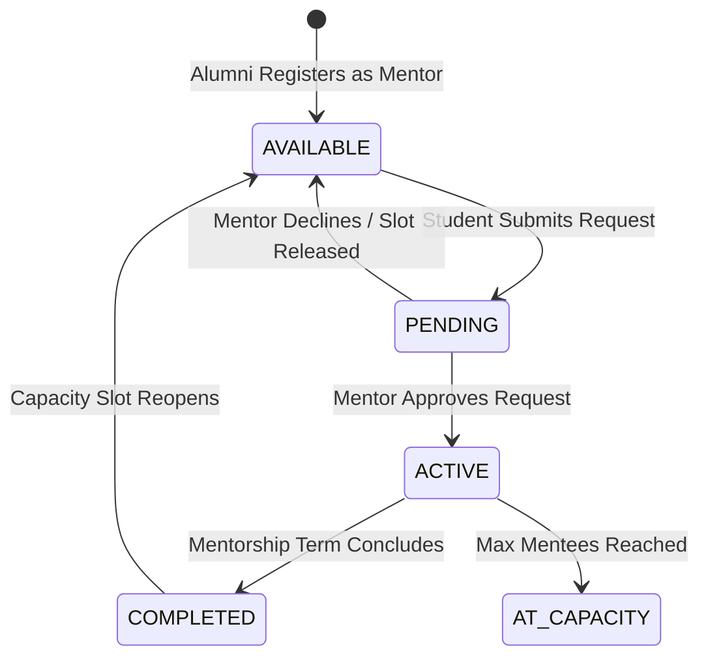

# AlumniNexus (`alumni`)

### Intelligent Alumni Career Graph & Engagement Network
*Designed for graduates, students, and faculty of **Istanbul University Faculty of Economics, Department of Management Information Systems (Yönetim Bilişim Sistemleri - YBS)**.*

---

## 1. Executive Summary & Vision

**AlumniNexus** is a modern, containerized backend platform and career mobility engine engineered to bridge the generational divide between university alumni, current undergraduates, and academic leadership. Rather than serving as a static contact book, AlumniNexus models alumni data as an active **Career & Mentorship Graph**, delivering:

1. **Talent Discovery & Professional Mobility**: Granular tracking of graduate career trajectories across technology, banking, e-commerce, and enterprise consulting sectors.
2. **Algorithmic Mentorship Pairings**: Structured matching between senior alumni in leadership roles and current undergraduates seeking guidance.
3. **Institutional Telemetry for Academic Accreditations**: Automated empirical reporting on graduate employment velocity and curriculum alignment for accreditation evaluation boards (e.g., **YÖKAK**, **AACSB**).

```text
┌──────────────────────────────────────────────────────────────────────────────────┐
│                           AlumniNexus Core Architecture                          │
└────────────────────────────────────────┬─────────────────────────────────────────┘
                                         │
       ┌─────────────────────────────────┼─────────────────────────────────┐
       ▼                                 ▼                                 ▼
┌───────────────┐               ┌─────────────────┐               ┌────────────────┐
│ Talent Graph  │               │ Mentorship Hub  │               │ Accreditation  │
│  & Directory  │               │ & Compatibility │               │   Telemetry    │
└───────┬───────┘               └────────┬────────┘               └────────┬───────┘
        │                                │                                 │
        ├─ Parametric Cohort Search      ├─ Skill-Matching Algorithm       ├─ 6/12 Month KPIs
        ├─ Company & Industry Filters    ├─ Capacity-Governed Pairings     ├─ Regional Mobility
        ├─ JSON Skills Serialization     ├─ State Machine Lifecycle        ├─ Employer Distribution
        └─ Privacy-Aware Redaction       └─ Direct Referral Channels       └─ Automated Dossier Export
```

---

## 2. Core Functional Pillars

### 2.1 Parametric Graduate Directory & Talent Graph
- **Granular Academic Profiling**: Records student ID, matriculation year, graduation cohort, academic honors, and faculty advisors.
- **Dynamic Skill Taxonomy**: Stores multi-tag skill sets using native **MySQL JSON columns**, enabling queries across modern tech competencies (e.g., `Python`, `Spark`, `DevOps`, `FinTech`, `Cybersecurity`).
- **Privacy-Aware Ingestion**: Configurable visibility controls that redact phone numbers or personal emails for unauthenticated clients.

### 2.2 Mentorship State Machine & Matching Engine
- **Capacity-Controlled Mentor Slots**: Senior alumni publish active mentor availability with capacity constraints to prevent mentor overload.
- **Deterministic State Transition**: Tracks mentorship connections across formal stages:



### 2.3 Accreditation Telemetry & Career Heatmaps
- **Accreditation Readiness**: Real-time generation of graduate KPIs formatted for institutional review bodies (**YÖKAK**, **AACSB**, **ABET**).
- **Employment Velocity**: Metrics measuring percent of graduates placed in tech roles within 6 and 12 months post-convocation.
- **Domestic vs. Global Mobility**: Tracking alumni migration into European, North American, and domestic technology hubs.

### 2.4 Container Health & Observability Probe
- **Live Diagnostics Endpoint (`/api/v1/health`)**: Reports container memory footprint, PHP runtime metrics, and MySQL database connection health.

---

## 3. Technology Stack & Decision Rationale

| Architecture Layer | Selected Technology | Engineering Rationale | Limitation / Drawback |
| :--- | :--- | :--- | :--- |
| **Backend Runtime** | **PHP 8.2 (Strict Types)** | - **Zero Compilation Overhead**: Instant edit-and-run development loop.<br>- **Native Web Architecture**: Built specifically for HTTP request processing.<br>- **Modern PHP Standards**: Employs `declare(strict_types=1);`, Backed Enums (`UserRole`, `MentorshipStatus`), and DTO patterns without heavy external framework weight. | **Synchronous Concurrency**: PHP operates on a per-request lifecycle; high-volume real-time WebSocket pipelines require higher memory overhead than event-driven runtimes like Node.js or Go. |
| **Database Engine** | **MySQL 8.0** | - **Relational Data Integrity**: Academic cohorts, mentorship states, and alumni records demand strict foreign key constraints and ACID transaction guarantees.<br>- **Hybrid Schema Flexibility**: Native `JSON` column types allow flexible tagging of evolving skillsets alongside strict relational tables.<br>- **Container-Native**: Instant provisioning via official Docker images. | **Schema Rigidity**: Altering massive historical tables requires formal database migrations, and complex analytical window queries have less out-of-the-box flexibility than PostgreSQL. |
| **Containerization** | **Docker & Docker Compose** | - **Strict Reproducibility**: Satisfies the coursework rule (`docker compose up`) ensuring the stack runs identically on any evaluation machine with zero local setup. | **First-Run Overhead**: Initial build requires pulling MySQL and Apache base images. |
| **Developer Assistant**| **Antigravity** | - **Autonomous Agentic Execution**: Context-aware terminal orchestration, rapid code refactoring, and automated Dockerfile verification at zero cost. | **Newer Ecosystem**: Smaller repository of historical third-party troubleshooting threads compared to older assistants. |

---

## 4. Architectural Design & Directory Layout

AlumniNexus follows a **Domain-Driven Clean Architecture** with strict separation between public entry points and internal domain logic:

```text
alumni/
├── Dockerfile                  # Production-ready PHP 8.2 Apache container configuration
├── docker-compose.yml          # Multi-container orchestration (AlumniNexus API + MySQL 8.0)
├── AGENTS.md                   # AI Assistant operational context & architectural protocols
├── README.md                   # Complete system documentation, diagrams, and quickstart guide
├── .gitignore                  # Git exclusions for OS, containers, and temporary assets
│
├── public/                     # [Document Root] Public web access gateway
│   ├── .htaccess               # Apache URL rewrite rules to Front Controller
│   └── index.php               # Front Controller, PSR-4 autoloader & route dispatcher
│
├── src/                        # [Application Core] Domain logic & infrastructure
│   ├── Core/
│   │   ├── Database.php        # Type-safe PDO singleton connection wrapper
│   │   ├── Response.php        # Standardized JSON and HTML response serializer
│   │   └── Router.php          # Parametric regex route dispatcher
│   ├── Domain/
│   │   └── Enums/
│   │       ├── UserRole.php    # Backed Enum: ALUMNI, STUDENT, FACULTY, ADMIN
│   │       └── MentorshipStatus.php # Backed Enum: AVAILABLE, AT_CAPACITY, INACTIVE
│   ├── Services/
│   │   └── AlumniService.php   # Business logic, query filtering & career analytics
│   └── Controllers/
│       ├── AlumniApiController.php # REST API v1 endpoints
│       ├── HealthController.php    # Telemetry and system health probes
│       └── WebController.php       # Template dispatcher for browser views
│
├── templates/                  # [Presentation Layer] High-performance client views
│   ├── dashboard.html          # Modern SaaS-grade directory dashboard (Tailwind CSS)
│   ├── about.html              # Department overview & temporary about page
│   ├── analytics.html          # Career Graph mobility & accreditation dashboard
│   ├── swagger.html            # Dark-themed Swagger UI API Explorer
│   └── 404.html                # Error fallback template
│
├── database/
│   └── schema.sql              # MySQL DDL schema (InnoDB, JSON skills, composite indexes)
│
├── docs/
│   └── openapi.json            # OpenAPI 3.1.0 interactive contract specification
│
└── tests/
    └── run_tests.php           # Automated CLI assertion suite
```

---

## 5. How to Run the System

### Primary Method: Single-Command Docker Orchestration
In strict adherence to project evaluation instructions:

```bash
docker compose up --build
```

- Boots **MySQL 8.0** with health checks, automatically loading `database/schema.sql`.
- Boots **PHP 8.2 Apache**, routing traffic through `/public/index.php`.
- The application will be immediately live at: **`http://localhost:8080`**.
- Subdirectory deployments on local Apache/XAMPP (`http://localhost/alumni`) are automatically supported via dynamic base path normalization.

---

### Whiteboard Milestone Routes (`Routes / "auto"`)

| # | HTTP Method | Endpoint Pattern | Example URL | Expected Response / Output |
| :-: | :--- | :--- | :--- | :--- |
| **1** | `GET` / `POST` | `/` or `/auto` | `http://localhost:8080/auto` | `"ok"` |
| **2** | `GET` | `/hello` | `http://localhost:8080/hello` | `"Hello, World!"` |
| **3** | `GET` | `/hello/{name}` | `http://localhost:8080/hello/emre` | `"Hello, Emre!"` |
| **4** | `GET` | `/sum/{number1}/{number2}` | `http://localhost:8080/sum/15/25` | `40` (sum of number1 + number2) |
| **5** | `GET` | `/` | `http://localhost:8080/` | Temporary One Main Page (`templates/dashboard.html`) |
| **6** | `GET` | `/about` | `http://localhost:8080/about` | Temporary About Page (`templates/about.html`) |

---

### Week 03 Whiteboard Milestone: RESTful API & In-Memory User Management
*(Lecture: Assoc. Prof. Dr. Emre Akadal • Web Programming • Week 03)*

| Item # | HTTP Method | Endpoint | Description | Request Body Example | Expected Status |
| :-: | :--- | :--- | :--- | :--- | :-: |
| **①** | `GET` | `/api/health` | Health Check Probe (Returns JSON) | *None* | `200 OK` |
| **②** | *Tooling* | **Postman** | Import collection: `docs/AlumniNexus_Week03_Postman_Collection.json` | - | - |
| **③** | `POST` | `/api/users` | Create User *(Don't use any database yet)* | `{"name": "Elif Kaya", "graduationYear": 2024}` | `201 Created` |
| **④** | `GET` | `/api/users` | List All Users (In-Memory Dataset) | *None* | `200 OK` |
| **⑤** | `GET` | `/api/users/{id}` | Retrieve Single User by ID | *None* | `200 OK` / `404` |
| **⑤** | `PUT` | `/api/users/{id}` | Replace Entire User Object *(Slide C: replace whole)* | `{"name": "Elif Kaya Akın", "graduationYear": 2025}` | `200 OK` / `404` |
| **⑤** | `PATCH` | `/api/users/{id}` | Partial Update *(Slide C: change one field)* | `{"graduationYear": 2026}` | `200 OK` / `404` |
| **⑥** | `DELETE` | `/api/users/{id}` | Remove User Record *(Slide C: remove record)* | *None* | `200 OK` / `404` |
| **⑦** | `GET` | `/api/swagger` | Interactive Swagger UI API Documentation | *None* | `200 OK` |

> **Slide D Verification**:
> - Request body sent: `{"name": "Elif Kaya", "graduationYear": 2024}`
> - Response received: `HTTP/1.1 201 Created` with Content-Type `application/json`
> - Payload: `{"id": 42, "name": "Elif Kaya", "graduationYear": 2024}`
> - `/api/alumni` routes are also provided as direct aliases for live lecture testing.

---

### Key Application Routes Summary

| Surface | URL Path | Description |
| :--- | :--- | :--- |
| **Directory UI** | [`http://localhost:8080/`](http://localhost:8080/) | Interactive Alumni Directory with live search and cohort filters |
| **About Page** | [`http://localhost:8080/about`](http://localhost:8080/about) | Istanbul University MIS Department overview and accreditation |
| **Analytics UI** | [`http://localhost:8080/analytics`](http://localhost:8080/analytics) | Career mobility graph and institutional accreditation KPIs |
| **Swagger Explorer** | [`http://localhost:8080/api/swagger`](http://localhost:8080/api/swagger) | Interactive Swagger UI API documentation (Whiteboard Item 7) |
| **Health Probe** | [`http://localhost:8080/api/health`](http://localhost:8080/api/health) | System health probe returning JSON (Whiteboard Item 1) |
| **Users API** | [`http://localhost:8080/api/users`](http://localhost:8080/api/users) | Week 03 In-Memory User CRUD without database |
| **OpenAPI Spec** | [`http://localhost:8080/openapi.json`](http://localhost:8080/openapi.json) | Raw OpenAPI 3.1.0 JSON contract |

---

### Alternative: Standalone Local PHP Server (Without Docker)

```bash
php -S localhost:8000 -t public/
```

Run test suite via CLI:
```bash
php tests/run_tests.php
```

---

## 6. Academic Context & Course Information
- **Institution**: Istanbul University (`ogr.iu.edu.tr`)
- **Faculty**: Faculty of Economics (İktisat Fakültesi)
- **Department**: Management Information Systems (Yönetim Bilişim Sistemleri - YBS)
- **Repository**: `github.com/<your-username>/alumni`
- **License**: MIT
