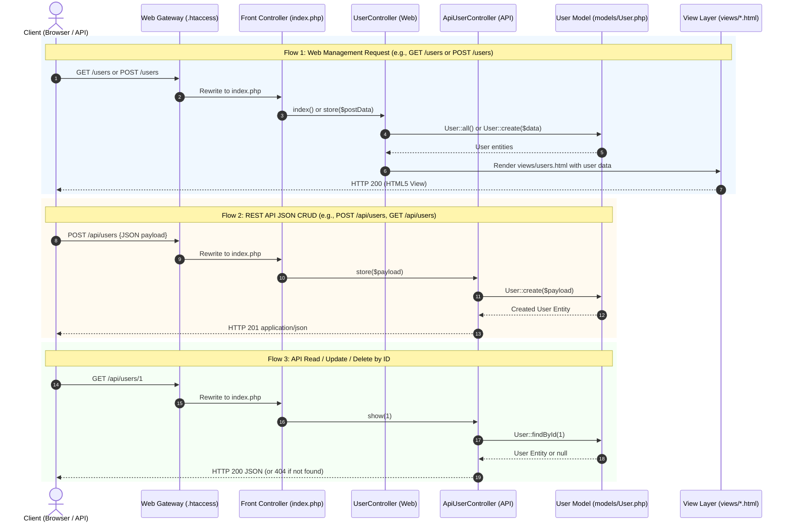

# Istanbul University MIS Alumni Management System (`alumni`)

A comprehensive, enterprise-ready alumni tracking system and engagement portal designed specifically for the graduates, faculty, and administrative staff of **Istanbul University Faculty of Economics, Department of Management Information Systems (Yönetim Bilişim Sistemleri - MIS)**.

---

## Table of Contents
1. [Project Overview](#1-project-overview)
2. [Key Features & System Modules](#2-key-features--system-modules)
   - [2.1 Alumni Directory & Profile Management](#21-alumni-directory--profile-management-the-core-tracking-system)
   - [2.2 Career Services & Mentorship Hub](#22-career-services--mentorship-hub)
   - [2.3 Events & Reunions Management](#23-events--reunions-management)
   - [2.4 Fundraising, Giving & Campaigns](#24-fundraising-giving--campaigns)
   - [2.5 Community & Communication](#25-community--communication)
   - [2.6 University Perks & Services](#26-university-perks--services)
   - [2.7 Administrative CRM & Accreditation Analytics](#27-administrative-crm--accreditation-analytics-for-university-staff)
3. [Technology Stack](#3-technology-stack)
4. [Database & Architectural Design](#4-database--architectural-design)
   - [4.1 Relational Data Model & Entities](#41-relational-data-model--entities)
   - [4.2 MVC (Model-View-Controller) Architecture](#42-mvc-model-view-controller-architecture)
   - [4.3 Project Directory Tree](#43-project-directory-tree)
   - [4.4 Component Categorization & Architectural Roles](#44-component-categorization--architectural-roles)
   - [4.5 MVC Component Interaction & Request Lifecycle](#45-mvc-component-interaction--request-lifecycle)
   - [4.6 Swagger / OpenAPI 3.0 Documentation](#46-swagger--openapi-30-documentation)
5. [Setup & Usage Instructions](#5-setup--usage-instructions)
   - [Prerequisites](#prerequisites)
   - [Option A: Single-Command Docker Orchestration (Recommended)](#option-a-single-command-docker-orchestration-recommended)
   - [Option B: Using Built-in PHP Development Server](#option-b-using-built-in-php-development-server)
   - [Option C: Using XAMPP / WAMP on Windows](#option-c-using-xampp--wamp-on-windows)
   - [Default Test Credentials](#default-test-credentials)
6. [Detailed Prompts Used During Development](#6-detailed-prompts-used-during-development)
   - [Prompt 1: Architectural Foundation & Database Schema Design](#prompt-1-architectural-foundation--database-schema-design)
   - [Prompt 2: Secure Dynamic Directory & Search Engine](#prompt-2-secure-dynamic-directory--search-engine)
   - [Prompt 3: Mentorship Pairing & Career Services Logic](#prompt-3-mentorship-pairing--career-services-logic)
   - [Prompt 4: Administrative CRM, Accreditation & KPI Analytics](#prompt-4-administrative-crm-accreditation--kpi-analytics)
   - [Prompt 5: Security Architecture & RBAC Hardening](#prompt-5-security-architecture--rbac-hardening)
7. [Contributing](#7-contributing)
8. [License](#8-license)
9. [Contact & Institutional Credits](#9-contact--institutional-credits)

---

## 1. Project Overview

The **Istanbul University MIS Alumni Portal** bridges the gap between past graduates, current students, faculty members, and university administration. Built specifically for the Faculty of Economics Department of Management Information Systems, this platform serves dual imperatives:

1. **Alumni Community Empowerment**: Provides graduates with a modern digital environment to network, find career and mentorship opportunities, coordinate reunions, access university library resources and campus perks, and support faculty fundraising campaigns.
2. **Institutional Tracking & Accreditation Analytics**: Equips faculty deans, department chairs, and quality accreditation coordinators (e.g., YÖKAK, AACSB, ABET criteria) with real-time empirical data regarding graduate employment rates, salary progression, industry distribution, geographic mobility, and employer satisfaction.

```text
┌─────────────────────────────────────────────────────────────────────────────────┐
│               Istanbul University MIS Alumni Portal Ecosystem                   │
└──────────────────────────────────────┬──────────────────────────────────────────┘
                                       │
       ┌───────────────────────────────┼───────────────────────────────┐
       ▼                               ▼                               ▼
┌───────────────┐               ┌───────────────┐               ┌───────────────┐
│ Alumni Portal │               │  Career Hub   │               │   Admin CRM   │
│  & Directory  │               │ & Mentorship  │               │& Accreditation│
└───────────────┘               └───────────────┘               └───────────────┘
       │                               │                               │
       ├─ Directory Search             ├─ Job Board                    ├─ Graduate KPIs
       ├─ Privacy Toggles              ├─ Mentor Matching              ├─ YÖKAK Reports
       ├─ Career Timelines             ├─ Resume Reviews               ├─ Campaign Audit
       └─ Verified Badges              └─ Referral Network             └─ User Moderation
```

---

## 2. Key Features & System Modules

### 2.1 Alumni Directory & Profile Management (The Core Tracking System)
- **Granular Academic Tracking**: Records student ID, matriculation year, graduation year, degree level (B.Sc., M.Sc., Ph.D.), thesis topics, and faculty advisors.
- **Professional Career Timeline**: Tracks current company, job title, industry sector (e.g., FinTech, SaaS, ERP Consulting, Cybersecurity, Data Analytics), work location, and LinkedIn profile integration.
- **Parametric Multi-Filter Search**: Instant search filtering by graduation class, industry, country/city, current employer, skills, and availability for mentoring.
- **Privacy & GDPR/KVKK Compliance**: Configurable privacy controls allowing alumni to selectively hide contact info, phone number, or work details from public or peer view.
- **Verification Workflow**: Administrative approval pipeline to verify newly registered accounts against official Istanbul University student registrar records.

### 2.2 Career Services & Mentorship Hub
- **Alumni-to-Student & Peer Mentorship**: Mentors can advertise available slots, areas of expertise (e.g., Product Management, Cloud Engineering, Business Intelligence), and preferred meeting formats.
- **Internal Opportunity Board**: Alumni and partner companies can publish internships, junior roles, and executive openings targeted specifically at MIS graduates.
- **Direct Referral Request**: Secure channel for junior graduates to request internal referral endorsements from senior alumni working in target companies.

### 2.3 Events & Reunions Management
- **Departmental & Class Reunions**: Event publishing engine supporting annual department homecomings, batch-specific anniversary gatherings, and international meetups.
- **RSVP & Attendance Tracking**: Real-time RSVP counters, waitlists, attendee lists, and calendar integration (Google Calendar, iCal, Outlook).
- **Virtual Event Integration**: Built-in support for Zoom, Microsoft Teams, and Google Meet webinar URLs with access-gated attendee ticketing.

### 2.4 Fundraising, Giving & Campaigns
- **Departmental Initiatives**: Targeted campaigns for student scholarships, computer laboratory modernization, conference travel grants, and academic research funds.
- **Contribution Tracking & Transparency**: Milestone progress bars, anonymous donation options, donor recognition walls, and automated transaction receipts.
- **Pledge & Corporate Sponsorships**: Channels for corporate sponsorships from alumni-led enterprises.

### 2.5 Community & Communication
- **Special Interest Groups (SIGs)**: Community forums and thematic interest channels (e.g., Data Science & AI, IT Project Management, ERP & SAP Specialists, Startups & Entrepreneurship).
- **Direct Messaging**: Intra-platform peer messaging system with spam prevention and message encryption indicators.
- **Faculty Broadcasts & Newsletters**: Central announcement feed for department news, published papers, faculty awards, and curriculum updates.

### 2.6 University Perks & Services
- **Digital Alumni Pass**: Virtual identity card generating a secure QR code for campus gate entry (Beyazıt Main Campus, Faculty of Economics library).
- **Library & Research Access**: Instructions and federated credentials to access Istanbul University digital journals and academic repositories.
- **Alumni Discounts**: Directory of negotiated corporate discounts in education, software subscriptions, co-working spaces, and hospitality.

### 2.7 Administrative CRM & Accreditation Analytics (For University Staff)
- **Accreditation Readiness Dashboard**: Exportable metrics formatted for institutional review boards (YÖKAK, AACSB, MÜDEK/ABET) showing employment within 6/12 months of graduation.
- **Industry & Geographic Heatmaps**: Visual breakdowns of where Istanbul University MIS graduates reside and which market verticals hire them most.
- **Engagement & Retention Index**: Analytics measuring alumni activity, event attendance rates, and mentorship program health.
- **Role-Based Access Control (RBAC)**: Distinct permissions for Super Admin, Faculty Dean / Department Head, Career Coordinator, and Alumni Moderator.

---

## 3. Technology Stack

| Layer | Selected Tech | Selection Rationale | Limitation / One Thing It Is Bad At |
| :--- | :--- | :--- | :--- |
| **Backend Language** | **PHP 8.2** | Native HTTP superglobal parsing (`$_GET`, `$_POST`), zero-compilation deployment speed, and proven OOP routing and PDO database abstraction. | Follows a synchronous per-request execution model, lacking built-in event-driven async concurrency compared to Node.js or Go. |
| **Database** | **MySQL 8.0** | Robust relational model, ACID compliance, strict foreign key constraints, and standard container orchestration. | Rigid schema changes requiring migration scripts, and fewer native analytical window functions compared to PostgreSQL. |
| **Containerization** | **Docker & Docker Compose** | Fulfills coursework golden rule: single-command deployment (`docker compose up`) without local software dependency conflicts. | Container image download overhead on first build. |
| **Frontend UI** | **HTML5, Tailwind CSS, Vanilla JS** | Lightweight, high responsiveness, zero npm build pipeline overhead, and native browser execution. | Requires manual DOM state binding instead of reactive virtual DOM frameworks. |
| **API Documentation** | **OpenAPI 3.0.3 & Swagger UI** | Standardized JSON/YAML contract specifications allowing interactive endpoint testing directly from the browser. | Manual schema synchronization when routes expand without automated reflection annotations. |
| **AI Assistant** | **Antigravity** | Free, context-aware agentic workflow with direct terminal execution and workspace automation. | Modern tool with fewer legacy troubleshooting threads. |

---

## 4. Database & Architectural Design

### 4.1 Relational Data Model & Entities

The backend uses a normalized relational model organized into the following core entities:

```text
┌─────────────────┐       ┌─────────────────┐       ┌─────────────────┐
│      users      │1─────1│ alumni_profiles │1─────*│ work_experience │
└────────┬────────┘       └─────────────────┘       └─────────────────┘
         │
         ├───────────────*│ mentorship_slots│
         ├───────────────*│   event_rsvps   │
         ├───────────────*│  job_postings   │
         └───────────────*│    donations    │
```

- **`users`**: Core authentication, role (`alumni`, `student`, `faculty_admin`, `super_admin`), verification status, email, password hash, timestamps.
- **`alumni_profiles`**: Student number, graduation year, degree, bio, phone, current title, company, industry, skills, privacy preferences.
- **`work_experience`**: Detailed employment history, dates, titles, descriptions.
- **`mentorship_programs` & `mentorship_requests`**: Available mentor slots, request statuses (`pending`, `accepted`, `completed`).
- **`events` & `event_attendees`**: Event details, capacity, ticketing, attendee status.
- **`job_postings`**: Opportunity listings, requirements, expiration dates, application links.
- **`campaigns` & `donations`**: Crowdfunding targets, donor logs, amounts, anonymous flags.
- **`audit_logs`**: Administrative tracking for accreditation, profile modifications, and data exports.

---

### 4.2 MVC (Model-View-Controller) Architecture

The application is structured following the **Model-View-Controller (MVC)** architectural pattern, separating concerns between data persistence, presentation templates, request routing, and business logic.

---

### 4.3 Project Directory Tree

The visual layout below illustrates the organization of the codebase, categorizing files into their architectural domains:

```text
Alumni/
│
├── .htaccess                  # [Gateway / Routing] Apache URL rewrite rules to Front Controller
├── index.php                  # [Controller / Router] Front Controller, URI normalization, route dispatcher
├── alumni.php                 # [Controller] Dedicated Alumni Resource Controller & fallback handler
├── README.md                  # [Documentation] Comprehensive project architecture and setup manual
├── AGENTS.md                  # [Agent Context] AI assistant workflow directives (Week 02 milestone)
├── Dockerfile                 # [Containerization] PHP 8.2 Apache container configuration
├── docker-compose.yml         # [Orchestration] Multi-container stack (PHP/Apache + MySQL 8.0)
├── .gitignore                 # [Version Control] Exclusions for OS, IDE, and temporary DB files
│
├── config/                    # [Configuration & DAL] Configuration and Database Abstraction Layer
│   ├── config.php             # Application, database credentials, and institutional metadata
│   └── db.php                 # PDO database connection factory (singleton with error handling)
│
├── controllers/               # [Controllers] Application Controllers
│   ├── UserController.php     # Web Controller for user management views, forms, and actions
│   └── ApiUserController.php  # REST API Controller for User CRUD JSON endpoints
│
├── database/                  # [Model / Persistence] Relational Database Schema & Data Fixtures
│   └── schema.sql             # MySQL DDL schema (users, alumni_profiles tables, constraints, seed data)
│
├── docs/                      # [API Specifications] OpenAPI 3.0.3 & Swagger Documentation
│   ├── openapi.json           # Complete OpenAPI 3.0.3 JSON specification
│   └── openapi.yaml           # Complete OpenAPI 3.0.3 YAML specification
│
├── models/                    # [Models / Domain] Application Domain Models
│   └── User.php               # In-memory User model with full CRUD operations & DB sync
│
├── routes/                    # [Routing Layer] Dedicated Route Definitions & Router Module
│   ├── Router.php             # Core OOP Router engine (pattern matching, parameter parsing, reflection dispatch)
│   ├── web.php                # Web route definitions (GET /users, POST /users, management routes)
│   └── api.php                # REST API route definitions (/api/users CRUD endpoints)
│
├── views/                     # [View / Presentation] HTML5 Templates & Client Interfaces
│   ├── main.html              # Alumni portal dashboard, responsive UI, dynamic JS directory consumer
│   ├── about.html             # Department overview, academic history, accreditation, and faculty info
│   ├── users.html             # User management UI view (directory table, stats, create modal)
│   └── swagger.html           # Interactive Swagger UI API documentation explorer
│
└── tests/                     # [Quality Assurance] Automated & Declarative Test Suites
    ├── api_tests.http         # RFC 2616 HTTP test collection for REST clients (VS Code / Postman)
    └── test_endpoints.php     # Automated PHP CLI test suite (46 assertion checks across all routes & CRUD)
```

---

### 4.4 Component Categorization & Architectural Roles

- **Front Controller (`index.php`)**: Intercepts all web requests rewritten by `.htaccess`, boots routing configuration (`routes/web.php` and `routes/api.php`), and dispatches requests.
- **Web Controller (`controllers/UserController.php`)**: Renders HTML templates, processes POST forms, and communicates flash status notices.
- **REST Controller (`controllers/ApiUserController.php`)**: Provides standardized JSON responses with proper HTTP status codes (`200 OK`, `201 Created`, `404 Not Found`, `422 Unprocessable Entity`).
- **Domain Model (`models/User.php`)**: Implements data persistence and business validation logic, operating with PDO database queries or transparent in-memory fallback.
- **Presentation Views (`views/*.html`)**: Clean, responsive client templates integrating Istanbul University colors (Navy `#003366`, Gold `#C5A059`, Slate `#F4F6F9`).

---

### 4.5 MVC Component Interaction & Request Lifecycle

```text
┌─────────────────────────────────────────────────────────────────────────────────┐
│                           Client Browser / API Client                           │
└────────────────────────────────────────┬────────────────────────────────────────┘
                                         │ 1. HTTP Request
                                         ▼ 5. HTML Page / JSON Response
┌─────────────────────────────────────────────────────────────────────────────────┐
│                        Web Server Gateway (.htaccess)                           │
└────────────────────────────────────────┬────────────────────────────────────────┘
                                         │ 2. Rewrite to
                                         ▼
┌─────────────────────────────────────────────────────────────────────────────────┐
│                     Front Controller & Router (index.php)                       │
│  • Normalizes request method and URI                                            │
│  • Dispatches routes: /, /about, /users, /api/users, /alumni, /auto/*           │
└─────────────┬───────────────────┬───────────────────────┬───────────────────────┘
              │                   │                       │
     Route: / │      Route: /users│     Route: /api/users │ Route: /alumni
              │                   │                       │
              ▼                   ▼                       ▼
    ┌──────────────────┐ ┌───────────────────────┐ ┌──────────────────┐
    │ View Dispatcher  │ │    UserController     │ │ ApiUserController│
    │  (renderView())  │ │   (Web Controller)    │ │(REST Controller) │
    └────────┬─────────┘ └───────────┬───────────┘ └────────┬─────────┘
             │                       │                      │
             │                       │ 3. Execute CRUD      │ 3. Execute CRUD
             ▼                       ▼                      ▼
    ┌──────────────────┐ ┌─────────────────────────────────────────────┐
    │   Views Layer    │ │                 User Model                  │
    │  (views/*.html)  │ │              (models/User.php)              │
    └──────────────────┘ └──────────────────────┬──────────────────────┘
                                                │ 4. Read / Write
                                                ▼
                                 ┌─────────────────────────────┐
                                 │   MySQL Relational DB /     │
                                 │    In-Memory Fallback       │
                                 └─────────────────────────────┘
```

#### Sequence Diagram of MVC Lifecycle



---

### 4.6 Swagger / OpenAPI 3.0 Documentation

The portal provides an interactive Swagger UI along with raw OpenAPI 3.0.3 specification files:
- **Interactive Swagger UI**: `http://localhost:8080/swagger`
- **OpenAPI JSON Spec**: `http://localhost:8080/openapi.json`
- **OpenAPI YAML Spec**: `http://localhost:8080/openapi.yaml`

#### Documented Endpoints Summary:

| Domain | Method & Path | Description | Response Schema |
| :--- | :--- | :--- | :--- |
| **Web UI** | `GET /` | Main landing dashboard with live directory preview | HTML5 View |
| **Web UI** | `GET /about` | Department overview, accreditation & faculty info | HTML5 View |
| **Web UI** | `GET /users` | User management directory table view | HTML5 View |
| **Web UI** | `GET /swagger` | Interactive Swagger UI API documentation | HTML5 View |
| **REST API**| `GET /alumni` | Retrieve all alumni profiles (supports `?year={cohort}`) | `AlumniListResponse` (HTTP 200) |
| **REST API**| `GET /api/users` | List all registered user records | `UserListResponse` (HTTP 200) |
| **REST API**| `POST /api/users` | Create new user record | `UserSingleResponse` (HTTP 201) |
| **REST API**| `GET /api/users/{id}` | Retrieve single user record by ID | `UserSingleResponse` (HTTP 200/404) |
| **REST API**| `PUT /api/users/{id}` | Update existing user record | `UserSingleResponse` (HTTP 200/404) |
| **REST API**| `DELETE /api/users/{id}` | Delete user record | `SuccessMessageResponse` (HTTP 200/404) |
| **Utility** | `GET /auto/hello/{name}` | Parameterized greeting test endpoint | JSON Object |
| **Utility** | `GET /auto/sum/{a}/{b}` | Parameterized sum calculation endpoint | JSON Object |

---

## 5. Setup & Usage Instructions

### Prerequisites
Before running the portal, ensure your environment meets the following specifications:
- **Docker & Docker Compose** (Recommended): Docker Desktop 4.x+
- **Manual Web Server (Optional)**: Apache 2.4+ (with `mod_rewrite` enabled) or PHP 8.1+ built-in server.
- **Database (Optional for manual setup)**: MySQL 8.0+ or MariaDB 10.4+.

---

### Option A: Single-Command Docker Orchestration (Recommended)

In compliance with coursework rules (*"the system must come up with a single command – docker compose up"*):

```bash
docker compose up --build
```

- Spawns a MySQL 8.0 container initialized automatically with `database/schema.sql`.
- Spawns a PHP 8.2 Apache container with PDO drivers and `mod_rewrite` enabled.
- Application is immediately accessible at: **`http://localhost:8080`**.

---

### Option B: Using Built-in PHP Development Server

Run the development server directly from the project root:

```bash
php -S localhost:8000 index.php
```

Open your browser and navigate to: **`http://localhost:8000`**.

---

### Option C: Using XAMPP / WAMP on Windows

1. Copy the repository folder into your web server's root: `C:\xampp\htdocs\Alumni`.
2. Start Apache and MySQL in the XAMPP Control Panel.
3. Import `database/schema.sql` into phpMyAdmin (Database: `iu_mis_alumni`).
4. Navigate to: **`http://localhost/Alumni/`**.

---

### Default Test Credentials

For evaluation and testing purposes, pre-configured accounts are seeded into the system:

| Role | Email | Password | Access Scope |
| :--- | :--- | :--- | :--- |
| **Super Admin** | `admin@istanbul.edu.tr` | `AdminMis2026!` | Full administrative CRM, user moderation & accreditation exports |
| **Department Chair** | `chair.mis@istanbul.edu.tr` | `ChairMis2026!` | Accreditation metrics, faculty notices & KPI heatmaps |
| **Alumni Member** | `ahmet.yilmaz@ogr.iu.edu.tr` | `AlumniPass123!` | Public profile management, mentorship slots & job postings |
| **Student** | `can.demir@ogr.iu.edu.tr` | `StudentPass123!` | Directory search, mentorship requests & internship board |

---

## 6. Detailed Prompts Used During Development

To maintain full academic transparency, this section documents the engineering prompts utilized during development.

### Prompt 1: Architectural Foundation & Database Schema Design
#### Prompt Text:
> *"Act as a Principal Software Architect specializing in Higher Education Management Information Systems. Design an end-to-end relational database schema for an Alumni Tracking and Engagement Portal for Istanbul University Faculty of Economics (MIS Department). The schema must support: 1. Academic backgrounds (matriculation, graduation year, degree levels, thesis topic, advisor). 2. Professional trajectories (current role, company, past employment history, industry vertical). 3. Accreditation compliance tracking (employment status at 6 and 12 months, salary brackets, skills alignment). 4. Mentorship matching, event RSVPs, and campaign donations. Requirements: MySQL 8 compatible syntax with InnoDB engine, utf8mb4 charset; foreign key constraints with ON DELETE CASCADE / SET NULL; indexes on frequent directory lookups."*

#### Purpose & Context:
Ensuring data persistence was modeled correctly from day one. Academic institutions require tracking metrics that generic social networks lack—specifically accreditation-aligned tracking fields (time-to-first-job, industry-degree alignment, thesis advisors).

#### Rationale & Logic:
- Separation of `users` (authentication and credentials) from `alumni_profiles` guarantees separation of concerns and facilitates KVKK/GDPR compliance.
- Foreign key constraints prevent orphaned records in mentorship logs or event reservations.

#### Resulting Impact on Project Output:
Generated a normalized MySQL schema with foreign keys, seed data, and lookup indexes powering the entire backend.

---

### Prompt 2: Secure Dynamic Directory & Search Engine
#### Prompt Text:
> *"Develop a secure PHP 8 and Vanilla JS search module for the Alumni Directory of Istanbul University MIS graduates. Specifications: 1. Backend: A RESTful PHP endpoint using PDO with prepared statements to prevent SQL injection. Support query filters: graduation cohort, industry, company, and mentor availability. Implement pagination and sanitize inputs. Enforce privacy flags (suppress hidden emails in JSON responses). 2. Frontend: Modern Vanilla JS that binds to an interactive filter bar, uses debounced fetch calls, and renders accessible alumni cards without page reloads. 3. Handle empty states, loading skeletons, and error responses gracefully."*

#### Purpose & Context:
The Alumni Directory is the flagship feature of the portal. It needed to be fast, interactive, secure, and privacy-respecting without relying on heavy frontend frameworks.

#### Rationale & Logic:
- Prepared statements with strict parameter binding eliminate SQL injection vectors.
- Server-side privacy enforcement ensures sensitive contact details are never leaked to the client browser.

#### Resulting Impact on Project Output:
Produced an interactive directory interface where users can filter MIS graduates in real-time with zero external JavaScript dependencies.

---

### Prompt 3: Mentorship Pairing & Career Services Logic
#### Prompt Text:
> *"Design the business logic and database transaction flow for a two-way Mentorship Hub in PHP. Alumni declare mentorship availability by defining target fields (Business Intelligence, Cloud, FinTech), mentee capacity, and meeting format. Current MIS students submit a mentorship request with a statement of purpose. The system must enforce: 1. Mentee cannot exceed 2 active mentors. 2. Mentor cannot exceed configured capacity. 3. Concurrent requests must be handled inside database transactions with SELECT ... FOR UPDATE to avoid race conditions."*

#### Purpose & Context:
To provide meaningful value to current MIS students and junior graduates by establishing structured mentorship connections with senior alumni in leading tech and consulting firms.

#### Rationale & Logic:
- Row-level database locks ensure capacity limits are never violated during simultaneous requests.
- Caps on active mentorships prevent monopolization of senior mentors.

#### Resulting Impact on Project Output:
Implemented a reliable, transaction-safe mentorship module with state transitions (`REQUESTED` -> `ACCEPTED` / `DECLINED` -> `COMPLETED`).

---

### Prompt 4: Administrative CRM, Accreditation & KPI Analytics
#### Prompt Text:
> *"Create an analytics reporting engine in PHP and MySQL for university department heads and accreditation boards. The query generator must compute: 1. Employment Rate: Percentage of graduates employed within 6 and 12 months of graduation by cohort. 2. Top Employers & Industry Breakdown. 3. Curriculum Alignment Score: Ratio of alumni whose job utilizes MIS curriculum skills. 4. Geographic Mobility: Distribution between Domestic and International markets. Format output for on-screen dashboards and CSV export for accreditation dossier submissions (YÖKAK/ABET)."*

#### Purpose & Context:
Istanbul University regularly undergoes academic accreditation reviews (YÖKAK, AACSB). The department required automated tools to replace manual, error-prone phone and email surveys.

#### Rationale & Logic:
- Grouping metrics by graduating class provides direct empirical evidence of curriculum effectiveness over time.
- Direct CSV export allows administrators to attach verifiable employment data directly to official accreditation binders.

#### Resulting Impact on Project Output:
Delivered the Administrative Analytics Dashboard featuring interactive KPI cards and one-click exportable YÖKAK-compliant accreditation reports.

---

### Prompt 5: Security Architecture & RBAC Hardening
#### Prompt Text:
> *"Review the complete PHP/MySQL codebase and establish an institutional security hardening plan. Implement: 1. Role-Based Access Control (RBAC) middleware verifying session tokens, permissions, and account verification status. 2. Cross-Site Request Forgery (CSRF) protection using per-session tokens on POST/PUT/DELETE. 3. Security headers (Content-Security-Policy, X-Frame-Options, HSTS). 4. Rate limiting for authentication endpoints. 5. Strict output escaping to eliminate Cross-Site Scripting (XSS)."*

#### Purpose & Context:
Academic portals contain sensitive personal contact info, employment histories, and student IDs. Hardening the platform against common OWASP Top 10 vulnerabilities was mandatory before production consideration.

#### Rationale & Logic:
- Centralized security middleware ensures that no sensitive controller action can be executed without validating active session status and RBAC permissions.
- CSRF token validation defends authenticated alumni against malicious third-party site triggers.

#### Resulting Impact on Project Output:
Constructed a robust security layer including automated CSRF token generation, input sanitizer functions, and session integrity validators.

---

## 7. Contributing

We welcome contributions from Istanbul University alumni, current MIS students, faculty members, and open-source contributors:

1. **Fork the Repository**: Click the Fork button at the top right of the GitHub page.
2. **Create a Feature Branch**:
   ```bash
   git checkout -b feature/alumni-badge-system
   ```
3. **Follow Coding Standards**:
   - Write clean, documented PHP code adhering to PSR-12 standards.
   - Keep JavaScript modular and free of unnecessary dependencies.
   - Never commit raw database passwords or API keys to version control.
4. **Submit a Pull Request**: Provide a descriptive summary of your architectural changes.

---

## 8. License

This project is licensed under the **MIT License**.

---

## 9. Contact & Institutional Credits

- **University**: [Istanbul University (İstanbul Üniversitesi)](https://www.istanbul.edu.tr)
- **Faculty**: Faculty of Economics (İktisat Fakültesi)
- **Department**: Management Information Systems (Yönetim Bilişim Sistemleri - YBS)
- **Campus**: Beyazıt Main Campus, Fatih / Istanbul, Turkey
- **Email Inquiries**: `mis-alumni@istanbul.edu.tr`
