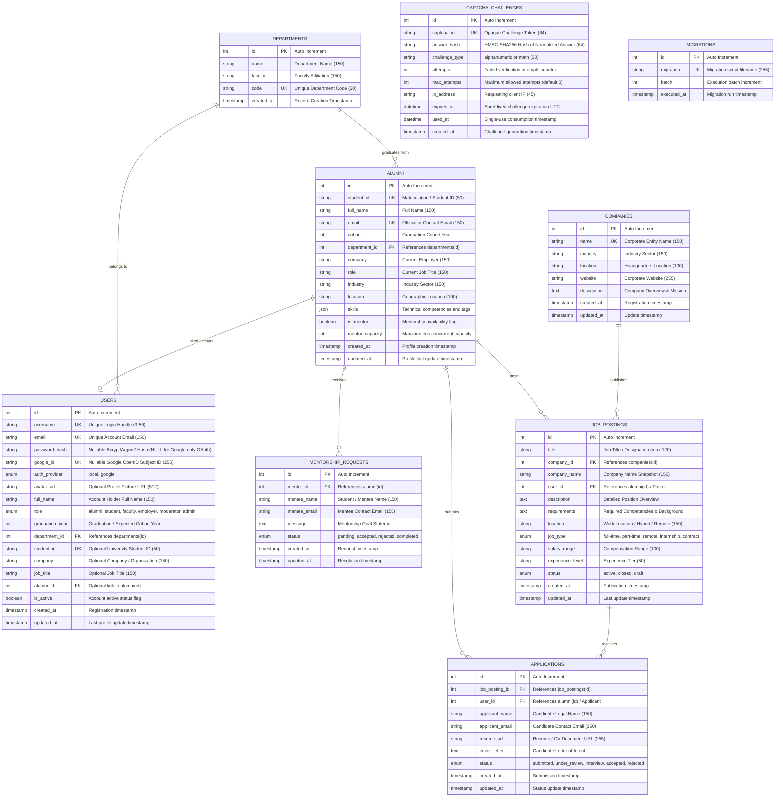
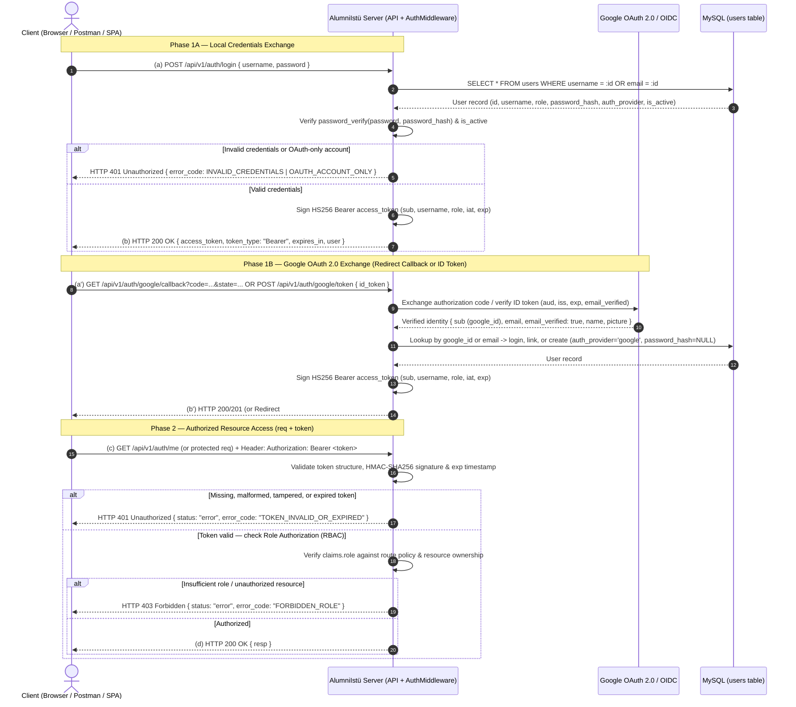
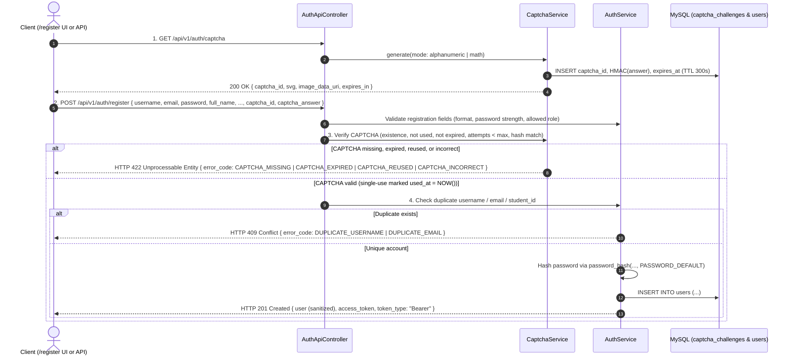

# Data Design Documentation (`ddd.md`)

> 🔗 **Bidirectional Navigation**: This document is linked to and from the primary system documentation.  
> [← Return to Main System Documentation (README.md)](./README.md)

---

## 1. Executive Data Architecture & Scope

**AlumniIstü** models graduate career mobilities, academic accreditations, and professional mentorship networks for the **Department of Management Information Systems (Yönetim Bilişim Sistemleri - YBS)** at **Istanbul University Faculty of Economics**.

This Data Design Document specifies the storage architecture, entity-relationship models, indexing strategies, persistence mechanisms, and disaster recovery invariants that govern the system.

---

## 2. Entity-Relationship Model (Mermaid ERD)



---

## 3. Physical Data Dictionary

### 3.1 Table: `departments`
Stores academic departments, faculties, and official codes.

| Column | Type | Constraints | Nullable | Default | Description |
| :--- | :--- | :--- | :--- | :--- | :--- |
| `id` | `INT` | `PRIMARY KEY AUTO_INCREMENT` | No | - | Unique department identifier |
| `name` | `VARCHAR(150)` | - | No | - | Full department name |
| `faculty` | `VARCHAR(150)` | - | No | - | Parent faculty name |
| `code` | `VARCHAR(20)` | `UNIQUE` | No | - | Department abbreviation code (e.g., `MIS-YBS`, `CENG`) |
| `created_at` | `TIMESTAMP` | - | No | `CURRENT_TIMESTAMP` | Initial registration timestamp |

---

### 3.2 Table: `alumni`
Core directory tracking graduate profiles, employment status, skillsets, and mentor quotas.

| Column | Type | Constraints | Nullable | Default | Description |
| :--- | :--- | :--- | :--- | :--- | :--- |
| `id` | `INT` | `PRIMARY KEY AUTO_INCREMENT` | No | - | Unique surrogate primary key |
| `student_id` | `VARCHAR(50)` | `UNIQUE` | No | - | University student matriculation number |
| `full_name` | `VARCHAR(150)` | - | No | - | Graduate legal name |
| `email` | `VARCHAR(150)` | `UNIQUE` | No | - | Validated contact email |
| `cohort` | `INT` | `INDEX (idx_cohort)` | No | - | Four-digit graduation year |
| `department_id` | `INT` | `FOREIGN KEY REFERENCES departments(id) ON DELETE SET NULL` | Yes | `NULL` | Associated academic department |
| `company` | `VARCHAR(150)` | - | Yes | `NULL` | Current corporate or institutional employer |
| `role` | `VARCHAR(150)` | - | Yes | `NULL` | Professional title or job role |
| `industry` | `VARCHAR(150)` | `INDEX (idx_industry)` | Yes | `NULL` | Primary industry sector |
| `location` | `VARCHAR(100)` | - | Yes | `NULL` | Primary city and country of residence |
| `skills` | `JSON` | - | Yes | `NULL` | Multi-tag list of technical competencies |
| `is_mentor` | `BOOLEAN` | `INDEX (idx_mentor)` | No | `FALSE` | Flag indicating mentorship willingness |
| `mentor_capacity`| `INT` | - | No | `0` | Active simultaneous mentee bandwidth limit |
| `created_at` | `TIMESTAMP` | - | No | `CURRENT_TIMESTAMP` | Profile creation timestamp |
| `updated_at` | `TIMESTAMP` | - | No | `CURRENT_TIMESTAMP ON UPDATE CURRENT_TIMESTAMP` | Automatic audit timestamp |

---

### 3.3 Table: `mentorship_requests`
Tracks incoming mentorship requests between current students/recent grads and senior mentors.

| Column | Type | Constraints | Nullable | Default | Description |
| :--- | :--- | :--- | :--- | :--- | :--- |
| `id` | `INT` | `PRIMARY KEY AUTO_INCREMENT` | No | - | Unique request identifier |
| `mentor_id` | `INT` | `FOREIGN KEY REFERENCES alumni(id) ON DELETE CASCADE` | No | - | Targeted mentor profile |
| `mentee_name` | `VARCHAR(150)` | - | No | - | Requesting student's name |
| `mentee_email`| `VARCHAR(150)` | - | No | - | Requesting student's contact email |
| `message` | `TEXT` | - | No | - | Statement of purpose and mentorship objectives |
| `status` | `ENUM` | `('pending', 'accepted', 'rejected', 'completed')` | No | `'pending'` | Lifecycle state of mentorship |
| `created_at` | `TIMESTAMP` | - | No | `CURRENT_TIMESTAMP` | Submission timestamp |
| `updated_at` | `TIMESTAMP` | - | No | `CURRENT_TIMESTAMP ON UPDATE CURRENT_TIMESTAMP` | Resolution timestamp |

---

### 3.4 Table: `migrations`
Internal schema versioning table managed by `database/migrate.php`.

| Column | Type | Constraints | Nullable | Default | Description |
| :--- | :--- | :--- | :--- | :--- | :--- |
| `id` | `INT` | `PRIMARY KEY AUTO_INCREMENT` | No | - | Migration execution sequence |
| `migration` | `VARCHAR(255)`| `UNIQUE` | No | - | Migration SQL file name |
| `batch` | `INT` | - | No | - | Batch sequence number |
| `executed_at`| `TIMESTAMP` | - | No | `CURRENT_TIMESTAMP` | Time migration was applied |

---

### 3.5 Table: `companies`
Corporate entities and enterprise employers hiring alumni and offering internships.

| Column | Type | Constraints | Nullable | Default | Description |
| :--- | :--- | :--- | :--- | :--- | :--- |
| `id` | `INT` | `PRIMARY KEY AUTO_INCREMENT` | No | - | Unique company identifier |
| `name` | `VARCHAR(150)` | `UNIQUE` | No | - | Official company / enterprise name |
| `industry` | `VARCHAR(150)` | `INDEX (idx_company_industry)` | Yes | `NULL` | Industry classification sector |
| `location` | `VARCHAR(100)` | - | Yes | `NULL` | Corporate headquarters or main branch |
| `website` | `VARCHAR(255)` | - | Yes | `NULL` | Company URL or career portal |
| `description` | `TEXT` | - | Yes | `NULL` | Corporate overview and profile |
| `created_at` | `TIMESTAMP` | - | No | `CURRENT_TIMESTAMP` | Company record creation timestamp |
| `updated_at` | `TIMESTAMP` | - | No | `CURRENT_TIMESTAMP ON UPDATE CURRENT_TIMESTAMP` | Last profile update timestamp |

---

### 3.6 Table: `job_postings`
Career opportunities, full-time roles, internships, and project contracts posted by companies or alumni.

| Column | Type | Constraints | Nullable | Default | Description |
| :--- | :--- | :--- | :--- | :--- | :--- |
| `id` | `INT` | `PRIMARY KEY AUTO_INCREMENT` | No | - | Unique job posting identifier |
| `title` | `VARCHAR(120)` | `Required, max 120 chars` | No | - | Position title (e.g. Lead Data Engineer) |
| `company_id` | `INT` | `FOREIGN KEY REFERENCES companies(id) ON DELETE SET NULL` | Yes | `NULL` | Associated hiring company |
| `company_name` | `VARCHAR(150)` | `Required` | No | - | Snapshot company name for display resilience |
| `user_id` | `INT` | `FOREIGN KEY REFERENCES alumni(id) ON DELETE SET NULL` | Yes | `NULL` | Alumni user who authored/published the post |
| `description` | `TEXT` | `Optional` | Yes | `NULL` | Comprehensive job description & duties |
| `requirements` | `TEXT` | `Optional` | Yes | `NULL` | Required qualifications, degrees, skills |
| `location` | `VARCHAR(150)` | `Optional` | Yes | `NULL` | Office location, City, Hybrid, or Remote |
| `job_type` | `ENUM` | `('full-time', 'part-time', 'remote', 'internship', 'contract')` | No | `'full-time'` | Employment contract modality |
| `salary_range` | `VARCHAR(100)` | `Optional` | Yes | `NULL` | Compensation range / salary band |
| `experience_level` | `VARCHAR(50)` | - | Yes | `'Mid-Level'` | Target seniority (Entry, Mid, Senior, Lead) |
| `status` | `ENUM` | `('active', 'closed', 'draft')` | No | `'active'` | Publication lifecycle state |
| `created_at` | `TIMESTAMP` | `INDEX (idx_job_created)` | No | `CURRENT_TIMESTAMP` | Publication timestamp |
| `updated_at` | `TIMESTAMP` | - | No | `CURRENT_TIMESTAMP ON UPDATE CURRENT_TIMESTAMP` | Last modification timestamp |

#### 3.6.1 Validation Rules & Domain Invariants (`JobPosting`)
As formally mandated by the backend architecture and classroom lecture requirements (Whiteboard Item 2 — Week 07):

| Field | Status | Constraint | Error Code | Error Message |
| :--- | :--- | :--- | :--- | :--- |
| `title` | **Required** | Non-empty string, max **120 characters** | `HTTP 422` | `"Validation error: 'title' is required."` / `"Validation error: 'title' must not exceed 120 characters."` |
| `Company` (`company` / `company_name`) | **Required** | Non-empty string or valid `company_id` reference | `HTTP 422` | `"Validation error: 'company' (or company_name) is required."` |
| `salary` (`salary` / `salary_range`) | **Optional** | May be omitted, empty, or `null` | — | — |
| `description` | **Optional** | May be omitted, empty, or `null` | — | — |
| `city` / `location` | **Optional** | May be omitted; defaults to `'Istanbul, Turkey'` | — | — |

**Detailed Specifications:**

- **`title`**:
  - **Status**: **Required**.
  - **Constraint**: String, **maximum 120 characters** (`1 <= mb_strlen(trim($title)) <= 120`).
  - **Error Behavior**: Requests omitting `title` or providing an empty/whitespace string return `HTTP 422 Unprocessable Entity` with message `"Validation error: 'title' is required."`. If `title` exceeds 120 characters, returns `HTTP 422 Unprocessable Entity` with message `"Validation error: 'title' must not exceed 120 characters."`.
  - **Implementation**: [`JobPostingApiController::validateJobPostingInput()`](./src/Controllers/JobPostingApiController.php)

- **`Company` (`company` / `company_name`)**:
  - **Status**: **Required**.
  - **Constraint**: Must be a non-empty string or refer to a valid `company_id`. Accepts `company`, `company_name`, or `company_id` interchangeably.
  - **Error Behavior**: Requests lacking all company fields return `HTTP 422 Unprocessable Entity` with message `"Validation error: 'company' (or company_name) is required."`.

- **`salary` (`salary` / `salary_range`)**:
  - **Status**: **Optional**.
  - **Constraint**: May be omitted, empty, or `null`. When provided, represents compensation band (e.g., `₺95,000 - ₺130,000 / month`).

- **`description`**:
  - **Status**: **Optional**.
  - **Constraint**: May be omitted, empty, or `null`. When provided, contains detailed responsibilities and role description.

- **`city` / `location`**:
  - **Status**: **Optional**.
  - **Constraint**: May be omitted or set to specific city / remote modality. Defaults to `'Istanbul, Turkey'` when unspecified.

---

### 3.7 Table: `applications`
Candidate job applications submitted by students and alumni for published job opportunities.

| Column | Type | Constraints | Nullable | Default | Description |
| :--- | :--- | :--- | :--- | :--- | :--- |
| `id` | `INT` | `PRIMARY KEY AUTO_INCREMENT` | No | - | Unique application identifier |
| `job_posting_id`| `INT` | `FOREIGN KEY REFERENCES job_postings(id) ON DELETE CASCADE` | No | - | Target job vacancy |
| `user_id` | `INT` | `FOREIGN KEY REFERENCES alumni(id) ON DELETE SET NULL` | Yes | `NULL` | Applying alumni/student profile (optional) |
| `applicant_name`| `VARCHAR(150)` | - | No | - | Candidate full legal name |
| `applicant_email`| `VARCHAR(150)` | - | No | - | Candidate contact email |
| `resume_url` | `VARCHAR(255)` | - | Yes | `NULL` | Link to candidate CV / portfolio document |
| `cover_letter` | `TEXT` | - | Yes | `NULL` | Candidate letter of intent / motivation |
| `status` | `ENUM` | `('submitted', 'under_review', 'interview', 'accepted', 'rejected')` | No | `'submitted'` | Application review workflow state |
| `created_at` | `TIMESTAMP` | `INDEX (idx_app_created)` | No | `CURRENT_TIMESTAMP` | Application submission timestamp |
| `updated_at` | `TIMESTAMP` | - | No | `CURRENT_TIMESTAMP ON UPDATE CURRENT_TIMESTAMP` | Last review status update timestamp |

---

### 3.8 Table: `users`
Stores authenticated platform accounts, credentials, assigned RBAC roles, and academic/organizational profile links.

| Column | Type | Constraints | Nullable | Default | Description |
| :--- | :--- | :--- | :--- | :--- | :--- |
| `id` | `INT` | `PRIMARY KEY AUTO_INCREMENT` | No | - | Unique user account identifier |
| `username` | `VARCHAR(50)` | `UNIQUE` | No | - | Login handle (`3–50` chars: letters, digits, `.`, `_`, `-`) |
| `email` | `VARCHAR(150)` | `UNIQUE` | No | - | Unique validated contact/login email address |
| `password_hash` | `VARCHAR(255)` | - | Yes | `NULL` | Salted hash via `password_hash(..., PASSWORD_DEFAULT)`; `NULL` for Google-OAuth-only accounts |
| `google_id` | `VARCHAR(255)` | `UNIQUE` | Yes | `NULL` | Verified Google OpenID Connect `sub` identifier for OAuth sign-in & account linking |
| `auth_provider` | `ENUM` | `('local','google')`, `INDEX (idx_users_auth_provider)` | No | `'local'` | Primary identity provider (`local` password or `google` OAuth 2.0) |
| `avatar_url` | `VARCHAR(512)` | - | Yes | `NULL` | Optional avatar image URL (populated from Google profile picture when available) |
| `full_name` | `VARCHAR(150)` | - | No | - | Account holder full legal name |
| `role` | `ENUM` | `('alumni','student','faculty','employer','moderator','admin')`, `INDEX (idx_users_role)` | No | `'alumni'` | Assigned RBAC authorization role |
| `graduation_year` | `INT` | `INDEX (idx_users_graduation_year)` | Yes | `NULL` | Graduation or expected graduation cohort year (`1950–2035`) |
| `department_id` | `INT` | `FOREIGN KEY REFERENCES departments(id) ON DELETE SET NULL` | Yes | `NULL` | Affiliated academic department |
| `student_id` | `VARCHAR(50)` | `UNIQUE` | Yes | `NULL` | Optional university matriculation number |
| `company` | `VARCHAR(150)` | - | Yes | `NULL` | Current employer or recruiting organization |
| `job_title` | `VARCHAR(150)` | - | Yes | `NULL` | Professional job title or role designation |
| `alumni_id` | `INT` | `FOREIGN KEY REFERENCES alumni(id) ON DELETE SET NULL` | Yes | `NULL` | Optional link to the public `alumni` directory profile |
| `is_active` | `BOOLEAN` | - | No | `TRUE` | Whether the account is active and allowed to authenticate |
| `created_at` | `TIMESTAMP` | - | No | `CURRENT_TIMESTAMP` | Registration timestamp |
| `updated_at` | `TIMESTAMP` | - | No | `CURRENT_TIMESTAMP ON UPDATE CURRENT_TIMESTAMP` | Last account modification timestamp |

---

### 3.9 Table: `captcha_challenges`
Stores short-lived, single-use server-side CAPTCHA challenges used to block automated bot registrations.

| Column | Type | Constraints | Nullable | Default | Description |
| :--- | :--- | :--- | :--- | :--- | :--- |
| `id` | `INT` | `PRIMARY KEY AUTO_INCREMENT` | No | - | Internal surrogate primary key |
| `captcha_id` | `VARCHAR(64)` | `UNIQUE` | No | - | Opaque challenge identifier issued to the client (`cap_...`) |
| `answer_hash` | `VARCHAR(64)` | - | No | - | Server-side HMAC-SHA256 digest of the normalized expected answer (plaintext is never persisted) |
| `challenge_type` | `VARCHAR(30)` | - | No | `'alphanumeric'` | Challenge format (`alphanumeric` distorted SVG or `math` arithmetic SVG) |
| `attempts` | `INT` | - | No | `0` | Count of failed verification attempts against this challenge |
| `max_attempts` | `INT` | - | No | `5` | Maximum permitted attempts before automatic challenge invalidation |
| `ip_address` | `VARCHAR(45)` | - | Yes | `NULL` | Client IPv4/IPv6 address recorded at issuance |
| `expires_at` | `DATETIME` | `INDEX (idx_captcha_expires)` | No | - | Short-TTL expiration timestamp (default: `300` seconds) |
| `used_at` | `DATETIME` | `INDEX (idx_captcha_used)` | Yes | `NULL` | Populated on consumption to strictly forbid replay/reuse |
| `created_at` | `TIMESTAMP` | - | No | `CURRENT_TIMESTAMP` | Challenge creation timestamp |

---

## 4. Technical Storage & Engine Decisions

1. **Storage Engine: InnoDB**
   - **ACID Transactions**: Required to ensure atomic state updates across mentorship quotas, profile modifications, and migration transactions.
   - **Row-Level Locking**: High read/write throughput without blocking concurrent directory searches.
   - **Foreign Key Enforcement**: Guarantees referential integrity between `alumni` and `departments`.

2. **Character Set: `utf8mb4` with `utf8mb4_unicode_ci`**
   - Essential for flawless rendering and sorting of Turkish characters (`ç`, `ğ`, `ı`, `ö`, `ş`, `ü`, `Ç`, `Ğ`, `İ`, `Ö`, `Ş`, `Ü`) in student names, company titles, and department designations.

3. **Hybrid Schema: Relational + Native JSON**
   - High-cardinality metadata (cohorts, student IDs, department relationships) is stored in strict relational columns with explicit constraints.
   - Fluid skillsets (`skills`) are stored in MySQL native `JSON` columns, enabling flexible tag arrays without cumbersome junction tables, while maintaining indexing capabilities.

---

## 5. The Forgetting Test Protocol (Secret / Persistence Validation)

### 5.1 The Architectural Problem
By default, Docker container filesystems are ephemeral. Without an explicit persistent volume, executing:
```bash
docker compose down
docker compose up
```
destroys and recreates the container, causing MySQL to re-initialize its data directory and completely "forget" newly created records.

### 5.2 The Architectural Solution
AlumniIstü employs an isolated **Docker Named Volume** (`nexus_mysql_data`) mounted to the MySQL container storage root:

```yaml
services:
  db:
    volumes:
      - nexus_mysql_data:/var/lib/mysql

volumes:
  nexus_mysql_data:
    driver: local
```

Because named volumes are decoupled from container lifecycles:
1. `docker compose down` halts and removes containers, networks, and images, but leaves `nexus_mysql_data` untouched on the host filesystem.
2. `docker compose up` spins up fresh containers and re-attaches `nexus_mysql_data`, instantly recovering all accumulated rows, indexes, and transactions.

### 5.3 Automated Verification Protocol
To execute the automated forgetting test:
```bash
./tests/forgetting_test.sh
```

**Step-by-Step Verification Flow**:
```text
1. [CREATE]  POST /api/v1/alumni
             Payload: {"name": "Ada Lovelace", "email": "ada@cv.edu.tr", ...}
             Result: HTTP 201 Created (ID: #42)
             
2. [DOWN]    docker compose down
             Containers removed; persistent volume nexus_mysql_data preserved.
             
3. [UP]      docker compose up -d
             New containers launched; nexus_mysql_data remounted.
             
4. [CHECK]   GET /api/v1/alumni/42
             Result: HTTP 200 OK (Data intact)
             VERIFICATION: PASS ✔
```

---

## 6. Migration and Seeding Lifecycle

- **Migrations**: Executed via `php database/migrate.php [up|status|fresh]`.
- **Factory**: Generated via `AlumniIstü\Database\Factories\AlumniFactory`.
- **Seeder**: Seeded via `php database/seed.php [--count=20]`.

---

## 7. Middleware Architecture & Error Guardian System (Week 07)

AlumniIstü implements an enterprise-grade three-layer middleware pipeline enforced on every incoming HTTP request. All middleware classes reside in `src/Middleware/` and are registered via `public/index.php` before the router resolves.

### 7.1 Request Logger Middleware (`LoggerMiddleware`)

**File**: [`src/Middleware/LoggerMiddleware.php`](./src/Middleware/LoggerMiddleware.php)

Provides real-time HTTP telemetry output directly to the terminal (stdout + stderr) on every request lifecycle.

**Log Format:**
```
[time] [method] [route] [res.type] [duration]
```

**Example terminal row:**
```
12:20:30 Post /user 201 18 ms
10:20:30 Get /api/v1/alumni 200 5 ms
09:15:44 Delete /api/v1/job-postings/3 204 11 ms
```

**Implementation Details:**
- Registered via `LoggerMiddleware::start($method, $uri)` at the top of `public/index.php`.
- Uses `register_shutdown_function()` to guarantee log emission even when handlers call `exit;` (e.g., via `Response::json()`).
- Outputs simultaneously to `php://stdout`, `php://stderr`, and PHP `error_log()` for Docker container compatibility.
- Log buffer accessible via `LoggerMiddleware::getLogs()` for automated test assertions.

| Property | Value |
| :--- | :--- |
| **Output Target** | Terminal (stdout + stderr) |
| **Trigger** | Every HTTP request |
| **Shutdown Hook** | Yes — always logs even on early exit |
| **Test Accessible** | Yes — `LoggerMiddleware::getLogs()` |

---

### 7.2 404 Guardian Middleware (`NotFoundGuardianMiddleware`)

**File**: [`src/Middleware/NotFoundGuardianMiddleware.php`](./src/Middleware/NotFoundGuardianMiddleware.php)  
**Alias**: [`src/Middleware/Guardian404Middleware.php`](./src/Middleware/Guardian404Middleware.php)

Intercepts all unmatched routes and non-existent resource lookups, returning structured, human-readable 404 responses.

**API Response Format (JSON):**
```json
{
  "status": "error",
  "code": 404,
  "guardian": "404 Guardian Middleware",
  "message": "Resource or endpoint not found",
  "reason": "The requested endpoint 'GET /api/v1/unknown' does not exist on this server.",
  "method": "GET",
  "path": "/api/v1/unknown",
  "timestamp": "2026-11-11T12:00:00+03:00"
}
```

**Browser Response:** Renders `templates/404.html` dark-mode error template with diagnostic badges.

**Implementation Details:**
- Automatically invoked by the Router when no matching route is found.
- `NotFoundGuardianMiddleware::guard($method, $uri, $customReason)` can be called from any controller.
- `NotFoundGuardianMiddleware::abort($reason)` shortcut for inline 404 termination.
- Smart content negotiation: JSON for API requests (`/api/`), HTML for browser requests.

| Property | Value |
| :--- | :--- |
| **HTTP Status** | `404 Not Found` |
| **JSON Trigger** | Accept: `application/json` or path starts with `/api/` |
| **HTML Trigger** | Browser requests (renders `templates/404.html`) |
| **Custom Reason** | Yes — via `guard()` / `abort()` |

**Graceful Redirections (Generic 404 & Redirection):**

| Incoming URL | Redirect Target | Behavior |
| :--- | :--- | :--- |
| `/home` | `/` | `302 Redirect` |
| `/job` | `/jobs` | `302 Redirect` |
| `/job-postings` | `/jobs` | `302 Redirect` |
| `/application` | `/applications` | `302 Redirect` |
| Any unknown `/api/*` | — | `404 JSON response` |
| Any unknown browser URL | — | `404 HTML template` |

---

### 7.3 5xx Server Error Guardian (`ServerErrorGuardianMiddleware`)

**File**: [`src/Middleware/ServerErrorGuardianMiddleware.php`](./src/Middleware/ServerErrorGuardianMiddleware.php)  
**Alias**: [`src/Middleware/Guardian5xxMiddleware.php`](./src/Middleware/Guardian5xxMiddleware.php)

Intercepts all uncaught exceptions, runtime errors, and PHP fatal errors to prevent raw crash output and ensure clean 500 responses are always returned.

**API Response Format (JSON):**
```json
{
  "status": "error",
  "code": 500,
  "guardian": "5xx Guardian Middleware",
  "error": "Internal Server Error",
  "message": "An unexpected server error occurred.",
  "reason": "An internal execution error was intercepted safely by 5xx Guardian Middleware. Details logged to logs/error.logs.",
  "error_id": "err_671452c4",
  "path": "/api/v1/alumni",
  "method": "POST",
  "timestamp": "2026-11-11T12:00:00+03:00"
}
```

**Implementation Details:**
- `ServerErrorGuardianMiddleware::register()` is called at the very top of `public/index.php`, before any routing.
- Registers three PHP handlers: `set_exception_handler()`, `set_error_handler()`, and `register_shutdown_function()`.
- Never leaks environment secrets, database credentials, or internal file paths in public responses.
- Generates a unique `error_id` (e.g., `err_671452c4`) per incident for traceability.

| Property | Value |
| :--- | :--- |
| **HTTP Status** | `500 Internal Server Error` |
| **Handlers Registered** | Exception, Error, Shutdown (fatal) |
| **Log Destination** | `logs/error.logs` |
| **Error ID** | Unique hex token per incident |
| **Secret Leakage** | None — sanitized response only |

---

### 7.4 Error Logging to File (`logs/error.logs`)

**File**: `logs/error.logs`

The 5xx Guardian automatically ensures the `logs/` directory is created if absent, then appends structured incident records.

**Log Entry Format:**
```
[2026-11-11 12:00:00] [500] [ID:err_671452c4] [POST /api/v1/alumni]
Error: RuntimeException: Database connection refused
File: /var/www/html/src/Core/Database.php:42
Trace:
#0 /var/www/html/src/Models/Alumni.php(85): AlumniIstü\Core\Database::getConnection()
#1 /var/www/html/public/index.php(210): AlumniIstü\Controllers\AlumniApiController->create()
#2 {main}
--------------------------------------------------------------------------------
```

**Key Properties:**
- Directory auto-creation: `logs/` is created with `0777` permissions if it does not exist.
- File appended with `FILE_APPEND | LOCK_EX` for concurrent write safety.
- Also mirrors to Apache/PHP `error_log()` for Docker container log aggregation.
- Log file is excluded from version control via `.gitignore` (`.logs` pattern).

---

### 7.5 Middleware Registration & Execution Order

```
HTTP Request
     │
     ▼
┌─────────────────────────────────────────────────────┐
│  5xx Guardian (global exception/shutdown handlers)  │  ← registered first (ServerErrorGuardianMiddleware::register())
└──────────────────────────┬──────────────────────────┘
                           │
                           ▼
┌─────────────────────────────────────────────────────┐
│  Logger Middleware (start timer + shutdown hook)    │  ← LoggerMiddleware::start($method, $uri)
└──────────────────────────┬──────────────────────────┘
                           │
                           ▼
┌─────────────────────────────────────────────────────┐
│  Router::resolve() — dispatches matched route       │
│    └─ No match found → 404 Guardian                 │  ← NotFoundGuardianMiddleware::guard()
│    └─ Exception thrown → 5xx Guardian               │  ← ServerErrorGuardianMiddleware::handleException()
└──────────────────────────┬──────────────────────────┘
                           │
                           ▼
┌─────────────────────────────────────────────────────┐
│  Shutdown Hook fires — Logger emits terminal line   │  ← [time] [method] [route] [status] [duration]
└─────────────────────────────────────────────────────┘
```

---

## 8. Users, Roles, Authentication & Authorization Architecture

This section defines the domain identity model, Role-Based Access Control (RBAC) policies, token-based Client–Server authentication and authorization protocol, and anti-bot CAPTCHA registration verification rules for **AlumniIstü**.

### 8.1 User Entities & Role Taxonomy

Every actor interacting with AlumniIstü maps either to the unauthenticated `guest` state or to an authenticated `users` record backed by the [`UserRole`](./src/Domain/Enums/UserRole.php) PHP 8.2 enum:

| Role Identifier | Display Label | Self-Registrable? | Domain Profile & Responsibilities |
| :--- | :--- | :---: | :--- |
| `guest` *(unauthenticated)* | Guest / Public Visitor | — | Unauthenticated browser or API client. May view public pages (`/`, `/jobs`, `/about`, `/analytics`, `/swagger`, `/register`), request CAPTCHA challenges, register a new account, and log in. Cannot mutate protected resources or access private account endpoints. |
| `student` | Current Undergraduate | **Yes** | Active Istanbul University student (e.g., YBS/MIS undergraduate). Can browse the alumni directory, view job/internship postings, submit job applications, request mentorship from available alumni mentors, and manage their own account profile. |
| `alumni` *(default / registered `user`)* | Graduate / Alumni | **Yes** | Verified university graduate (standard registered `user` entity). Inherits student capabilities plus can maintain a public alumni directory profile, opt in as a mentor (`is_mentor`, `mentor_capacity`), accept/reject incoming mentorship requests, and publish career referrals/job postings on behalf of their organization. |
| `employer` | Corporate Employer / Recruiter | **Yes** | External hiring partner or corporate talent representative. Can register/manage their company profile, publish and update job postings for their organization, and review/transition candidate applications (`submitted → under_review → interview → accepted/rejected`). |
| `faculty` | Academic Staff / Faculty | **No** *(admin-provisioned)* | Istanbul University faculty members and accreditation reviewers. Read access to institutional career-graph analytics, cohort placement telemetry, and accreditation export metrics (YÖKAK / AACSB); can verify academic department metadata. |
| `moderator` | Network Moderator | **No** *(admin-provisioned)* | Department or community moderator. Can moderate, edit, or close inappropriate job postings, review mentorship conduct, and deactivate abusive accounts without full system-administration privileges. |
| `admin` | System Administrator | **No** *(admin-provisioned)* | Full platform governance across all resources: manage users and role assignments (including promoting accounts to `faculty`, `moderator`, or `admin`), manage departments/companies, override any directory/job/application record, and inspect system telemetry & error logs. |

> **Privilege Escalation Prevention Rule**: Public registration (`POST /api/v1/auth/register`) strictly permits only `alumni`, `student`, and `employer` roles. Any registration payload attempting to self-assign `faculty`, `moderator`, or `admin` is immediately rejected with `HTTP 422 Unprocessable Entity` before account creation.

---

### 8.2 Role-Based Access Control (RBAC) & Authorization Matrix

| Resource / Action | `guest` | `student` | `alumni` | `employer` | `faculty` | `moderator` | `admin` | Authorization Rule |
| :--- | :---: | :---: | :---: | :---: | :---: | :---: | :---: | :--- |
| **Public Pages & OpenAPI** (`/`, `/about`, `/swagger`, `/register`) | Allow | Allow | Allow | Allow | Allow | Allow | Allow | Public |
| **CAPTCHA & Auth** (`GET /auth/captcha`, `POST /auth/register`, `POST /auth/login`) | Allow | Allow | Allow | Allow | Allow | Allow | Allow | Public (CAPTCHA required on register) |
| **Own Session Profile** (`GET /api/v1/auth/me`) | Deny (`401`) | Allow | Allow | Allow | Allow | Allow | Allow | Authenticated (valid Bearer token) |
| **Alumni Directory Read** (`GET /api/v1/alumni`, `GET /api/v1/alumni/{id}`) | Read | Read | Read | Read | Read | Read | Read | Public read; private contact controls respected |
| **Alumni Profile Create / Update / Delete** | Deny (`401`) | Own only | Own only | Deny (`403`) | Read | Moderate | Full | Owner-only (`sub === owner_id`) or `admin` |
| **Job Postings Read** (`GET /api/v1/job-postings`) | Read | Read | Read | Read | Read | Read | Read | Public read |
| **Job Postings Create / Update / Close** | Deny (`401`) | Deny (`403`) | Own posts | Own company | Deny (`403`) | Moderate | Full | Role-restricted (`alumni`, `employer`, `moderator`, `admin`) + ownership check |
| **Applications Submit** (`POST /api/v1/applications`) | Deny (`401`) | Allow | Allow | Deny (`403`) | Deny (`403`) | Deny (`403`) | Full | Role-restricted (`student`, `alumni`, `admin`) |
| **Applications Review / Status Transition** (`PATCH /api/v1/applications/{id}`) | Deny (`401`) | Own withdraw | Own job posts | Own company posts | Read | Moderate | Full | Posting owner (`employer`/`alumni`) or `moderator`/`admin` |
| **Mentorship Request Submit / Respond** | Deny (`401`) | Submit | Submit & Respond | Deny (`403`) | Read | Moderate | Full | `student`/`alumni` submit; target mentor `alumni` responds |
| **Accreditation & Career Graph Analytics** (`GET /api/v1/analytics`) | Summary | Summary | Summary | Summary | Full | Full | Full | Summary public; detailed cohort/accreditation exports for `faculty`/`admin` |
| **User Role Management & System Config** | Deny (`401`) | Deny (`403`) | Deny (`403`) | Deny (`403`) | Deny (`403`) | Suspend only | Full | Strictly `admin` (`403 Forbidden` for all other roles) |

---

### 8.3 Token-Based Authentication & Authorization Flow (Client ↔ Server)

AlumniIstü implements stateless **Bearer Token Authentication** (HMAC-SHA256 signed JWTs via [`TokenService`](./src/Services/TokenService.php)) enforced by [`AuthMiddleware`](./src/Middleware/AuthMiddleware.php). Both local credential login and Google OAuth 2.0 issue the **exact same application Bearer token**, keeping downstream authorization uniform:



**Step-by-Step Protocol Specification:**

1. **(a) Client Sends Credentials or Google OAuth Credential**:
   - **Local Login**: Client submits `username` (or `email`) and `password` to `POST /api/v1/auth/login`.
   - **Google OAuth**: Client either completes the OAuth 2.0 redirect flow (`GET /api/v1/auth/google` → Google consent → `GET /api/v1/auth/google/callback?code=...&state=...`) or submits a Google ID token directly to `POST /api/v1/auth/google/token`.
2. **(b) Server Authenticates & Returns Response with Access Token (`response + token`)**:
   - For local credentials, the server verifies `password_verify()` against `users.password_hash` and checks `is_active = TRUE`.
   - For Google OAuth, the server verifies the CSRF `state` (for redirects), exchanges the authorization code / validates the ID token with Google (`aud === GOOGLE_CLIENT_ID`, `email_verified === true`), finds or creates the `users` row, and mints the application's HS256 Bearer token embedding `{ sub, username, email, role, iat, exp }`.
   - Returns `response + token`: `access_token`, `token_type: "Bearer"`, `expires_in` (default `3600` seconds), and the sanitized user profile (never returning `password_hash`).
3. **(c) Client Attaches Token on Subsequent Requests (`req + token`)**:
   - The client attaches the token to every protected request using the standard HTTP header:
     ```http
     Authorization: Bearer <access_token>
     ```
4. **(d) Server Validates Token, Checks Role Authorization & Returns Response (`resp`)**:
   - `AuthMiddleware` parses the Bearer token, validates its HMAC-SHA256 signature with constant-time `hash_equals()`, and verifies `exp > time()`.
   - Missing, invalid, or expired tokens are rejected with `HTTP 401 Unauthorized`.
   - For role-restricted endpoints, `AuthMiddleware::requireRole(...)` validates `claims['role']` against the endpoint's RBAC policy and rejects unauthorized roles with `HTTP 403 Forbidden`.
   - Authorized requests proceed to the controller and return the domain response (`resp`).

---

### 8.4 Dual Registration Methods & Security Rules (Standard + CAPTCHA & Google OAuth)

AlumniIstü supports two registration pathways, each enforcing strict anti-abuse and identity verification invariants before creating an account:

| Registration Method | Endpoint(s) | Anti-Bot / Identity Verification Rule | Stored Account State | Output |
| :--- | :--- | :--- | :--- | :--- |
| **1. Standard Form Registration** | `GET /api/v1/auth/captcha` → `POST /api/v1/auth/register` | **Mandatory server-side CAPTCHA verification** (short TTL, single-use, HMAC-hashed answer) before account creation + password strength & duplicate checks | `auth_provider = 'local'`, salted `password_hash`, `google_id = NULL`, role in `{alumni, student, employer}` | `HTTP 201` + sanitized user + HS256 Bearer token |
| **2. Google OAuth 2.0 Registration ("Continue with Google")** | `GET /api/v1/auth/google` → `GET /api/v1/auth/google/callback` *(browser)* or `POST /api/v1/auth/google/token` *(API/SPA)* | **Google OAuth 2.0 / OIDC verification**: signed CSRF `state`, valid Google code/token, `aud === GOOGLE_CLIENT_ID`, and `email_verified === true` (CAPTCHA bypassed because Google performs identity attestation) | New account: `auth_provider = 'google'`, `google_id = sub`, `password_hash = NULL`, default role `alumni` (or validated public role). Existing email: links `google_id` safely without overwriting local password/role. | `HTTP 201` (created) / `HTTP 200` (existing/linked) or browser redirect to `/register#oauth_token=...` |

#### 8.4.1 Standard Registration + CAPTCHA Verification Flow

To prevent automated spam accounts and credential-stuffing bots, **every standard registration request MUST pass server-side CAPTCHA verification before any user record is created**.



#### 8.4.2 Registration & CAPTCHA Validation Rules

| Field | Status | Constraint | HTTP Error | Error Code / Behavior |
| :--- | :--- | :--- | :---: | :--- |
| `username` | **Required** | `3–50` chars, regex `/^[a-zA-Z0-9._-]{3,50}$/`, unique | `422` / `409` | Format invalid (`422`) or already taken (`409 DUPLICATE_USERNAME`) |
| `email` | **Required** | Valid RFC email (`FILTER_VALIDATE_EMAIL`), max `150` chars, unique | `422` / `409` | Format invalid (`422`) or already registered (`409 DUPLICATE_EMAIL`) |
| `password` | **Required** | `8–128` chars, at least 1 letter and 1 digit; stored via `password_hash()` | `422` | Weak or too short password rejected before hashing |
| `password_confirmation` | **Optional** *(recommended in UI)* | When provided, must strictly equal `password` | `422` | Mismatch error |
| `full_name` (`name`) | **Required** | `2–150` chars trimmed non-empty string | `422` | Missing or too short |
| `role` | **Optional** *(default: `alumni`)* | Must be in public self-registration set: `alumni`, `student`, `employer` | `422` | Privileged roles (`faculty`, `moderator`, `admin`) rejected |
| `graduation_year` (`cohort`) | **Optional** | Integer between `1950` and `2035` | `422` | Out-of-range year rejected |
| `department_id` | **Optional** *(default: `1`)* | Positive integer matching a department ID | `422` | Invalid department ID |
| `student_id` | **Optional** | Max `50` chars, unique when provided | `422` / `409` | Duplicate student ID (`409 DUPLICATE_STUDENT_ID`) |
| `captcha_id` | **Required** | Non-empty opaque ID returned by `GET /api/v1/auth/captcha` | `422` | `CAPTCHA_MISSING` / `CAPTCHA_INVALID` |
| `captcha_answer` | **Required** | Must match server-stored `answer_hash` (case-insensitive, trimmed), unconsumed (`used_at IS NULL`), unexpired (`expires_at > NOW()`), and `< max_attempts` | `422` | `CAPTCHA_MISSING`, `CAPTCHA_EXPIRED`, `CAPTCHA_REUSED`, `CAPTCHA_INCORRECT`, or `CAPTCHA_MAX_ATTEMPTS` |

#### 8.4.3 Local Docker Out-of-the-Box CAPTCHA & Provider Configuration (`.env`)

- **Default Local Mode (`CAPTCHA_DRIVER=local_svg`)**: Generates distorted SVG text or arithmetic challenges natively in PHP 8.2 without requiring GD, Imagick, or external third-party API keys—working immediately with `docker compose up`.
- **Single-Use & Short TTL**: Challenges expire after `CAPTCHA_TTL_SECONDS` (default `300` seconds) and are immediately burned (`used_at` stamped) upon consumption to prevent replay attacks.
- **Pluggable External Provider Ready**: Switching to an external provider in production requires only updating `.env` (`CAPTCHA_DRIVER=turnstile` or `recaptcha`, `CAPTCHA_SITE_KEY`, `CAPTCHA_SECRET_KEY`) without changing client contracts.

#### 8.4.4 Google OAuth 2.0 Registration & Account Linking Rules

- **Environment Configuration**: Configured via `GOOGLE_CLIENT_ID`, `GOOGLE_CLIENT_SECRET`, and `GOOGLE_REDIRECT_URI` in `.env` (documented in `.env.example`).
- **CSRF State Protection**: `GET /api/v1/auth/google` generates a short-lived (`600s`) HMAC-SHA256 signed `state` token verified on callback to prevent CSRF/login-swap attacks.
- **Verified Email Requirement**: Google identities where `email_verified !== true` are rejected with `HTTP 422 Unprocessable Entity` (`GOOGLE_EMAIL_UNVERIFIED`).
- **Account Linking & Creation Precedence**:
  1. Match by `users.google_id` → authenticate existing account (`HTTP 200`).
  2. Match by verified `users.email` → attach `google_id` (preserving existing local `password_hash` and `role`), then authenticate (`HTTP 200`, `account_linked: true`).
  3. No existing account → create a new `users` record with `auth_provider = 'google'`, `password_hash = NULL`, auto-generated unique `username`, and default role `alumni` (or validated public role from `{alumni, student, employer}`), then issue the application's HS256 Bearer token (`HTTP 201`).
- **Graceful OAuth Error Handling**: Cancelled consent (`error=access_denied`), invalid/expired `state` (`OAUTH_INVALID_STATE`), failed code exchange (`OAUTH_TOKEN_EXCHANGE_FAILED`), invalid Google ID token (`GOOGLE_TOKEN_INVALID`), or missing OAuth `.env` credentials (`GOOGLE_OAUTH_NOT_CONFIGURED`) return structured JSON errors for API clients or clean error query redirects to `/register` for browser sessions.

---

[← Return to Main System Documentation (README.md)](./README.md)
