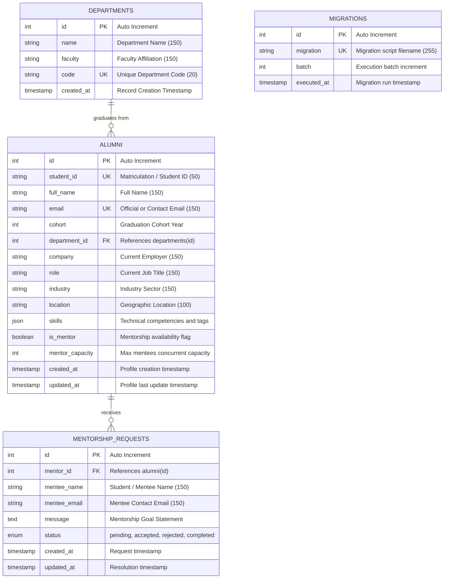

# Data Design Documentation (`ddd.md`)

> 🔗 **Bidirectional Navigation**: This document is linked to and from the primary system documentation.  
> [← Return to Main System Documentation (README.md)](./README.md)

---

## 1. Executive Data Architecture & Scope

**AlumniNexus** models graduate career mobilities, academic accreditations, and professional mentorship networks for the **Department of Management Information Systems (Yönetim Bilişim Sistemleri - YBS)** at **Istanbul University Faculty of Economics**.

This Data Design Document specifies the storage architecture, entity-relationship models, indexing strategies, persistence mechanisms, and disaster recovery invariants that govern the system.

---

## 2. Entity-Relationship Model (Mermaid ERD)



---

## 3. Physical Data Dictionary

### 3.1 Table: `departments`
Stores academic departments, faculties, and official codes.

| Column | Type | Constraints | Nullable | Default | Description |
| :--- | :--- | :--- | :--- | :--- | :--- |
| `id` | `INT` | `PRIMARY KEY AUTO_INCREMENT` | No | - | Unique department identifier |
| `name` | `VARCHAR(150)` | - | No | - | Full department name |
| `faculty` | `VARCHAR(150)` | - | No | - | Parent faculty name |
| `code` | `VARCHAR(20)` | `UNIQUE` | No | - | Department abbreviation code (e.g., `MIS-YBS`, `CENG`) |
| `created_at` | `TIMESTAMP` | - | No | `CURRENT_TIMESTAMP` | Initial registration timestamp |

---

### 3.2 Table: `alumni`
Core directory tracking graduate profiles, employment status, skillsets, and mentor quotas.

| Column | Type | Constraints | Nullable | Default | Description |
| :--- | :--- | :--- | :--- | :--- | :--- |
| `id` | `INT` | `PRIMARY KEY AUTO_INCREMENT` | No | - | Unique surrogate primary key |
| `student_id` | `VARCHAR(50)` | `UNIQUE` | No | - | University student matriculation number |
| `full_name` | `VARCHAR(150)` | - | No | - | Graduate legal name |
| `email` | `VARCHAR(150)` | `UNIQUE` | No | - | Validated contact email |
| `cohort` | `INT` | `INDEX (idx_cohort)` | No | - | Four-digit graduation year |
| `department_id` | `INT` | `FOREIGN KEY REFERENCES departments(id) ON DELETE SET NULL` | Yes | `NULL` | Associated academic department |
| `company` | `VARCHAR(150)` | - | Yes | `NULL` | Current corporate or institutional employer |
| `role` | `VARCHAR(150)` | - | Yes | `NULL` | Professional title or job role |
| `industry` | `VARCHAR(150)` | `INDEX (idx_industry)` | Yes | `NULL` | Primary industry sector |
| `location` | `VARCHAR(100)` | - | Yes | `NULL` | Primary city and country of residence |
| `skills` | `JSON` | - | Yes | `NULL` | Multi-tag list of technical competencies |
| `is_mentor` | `BOOLEAN` | `INDEX (idx_mentor)` | No | `FALSE` | Flag indicating mentorship willingness |
| `mentor_capacity`| `INT` | - | No | `0` | Active simultaneous mentee bandwidth limit |
| `created_at` | `TIMESTAMP` | - | No | `CURRENT_TIMESTAMP` | Profile creation timestamp |
| `updated_at` | `TIMESTAMP` | - | No | `CURRENT_TIMESTAMP ON UPDATE CURRENT_TIMESTAMP` | Automatic audit timestamp |

---

### 3.3 Table: `mentorship_requests`
Tracks incoming mentorship requests between current students/recent grads and senior mentors.

| Column | Type | Constraints | Nullable | Default | Description |
| :--- | :--- | :--- | :--- | :--- | :--- |
| `id` | `INT` | `PRIMARY KEY AUTO_INCREMENT` | No | - | Unique request identifier |
| `mentor_id` | `INT` | `FOREIGN KEY REFERENCES alumni(id) ON DELETE CASCADE` | No | - | Targeted mentor profile |
| `mentee_name` | `VARCHAR(150)` | - | No | - | Requesting student's name |
| `mentee_email`| `VARCHAR(150)` | - | No | - | Requesting student's contact email |
| `message` | `TEXT` | - | No | - | Statement of purpose and mentorship objectives |
| `status` | `ENUM` | `('pending', 'accepted', 'rejected', 'completed')` | No | `'pending'` | Lifecycle state of mentorship |
| `created_at` | `TIMESTAMP` | - | No | `CURRENT_TIMESTAMP` | Submission timestamp |
| `updated_at` | `TIMESTAMP` | - | No | `CURRENT_TIMESTAMP ON UPDATE CURRENT_TIMESTAMP` | Resolution timestamp |

---

### 3.4 Table: `migrations`
Internal schema versioning table managed by `database/migrate.php`.

| Column | Type | Constraints | Nullable | Default | Description |
| :--- | :--- | :--- | :--- | :--- | :--- |
| `id` | `INT` | `PRIMARY KEY AUTO_INCREMENT` | No | - | Migration execution sequence |
| `migration` | `VARCHAR(255)`| `UNIQUE` | No | - | Migration SQL file name |
| `batch` | `INT` | - | No | - | Batch sequence number |
| `executed_at`| `TIMESTAMP` | - | No | `CURRENT_TIMESTAMP` | Time migration was applied |

---

## 4. Technical Storage & Engine Decisions

1. **Storage Engine: InnoDB**
   - **ACID Transactions**: Required to ensure atomic state updates across mentorship quotas, profile modifications, and migration transactions.
   - **Row-Level Locking**: High read/write throughput without blocking concurrent directory searches.
   - **Foreign Key Enforcement**: Guarantees referential integrity between `alumni` and `departments`.

2. **Character Set: `utf8mb4` with `utf8mb4_unicode_ci`**
   - Essential for flawless rendering and sorting of Turkish characters (`ç`, `ğ`, `ı`, `ö`, `ş`, `ü`, `Ç`, `Ğ`, `İ`, `Ö`, `Ş`, `Ü`) in student names, company titles, and department designations.

3. **Hybrid Schema: Relational + Native JSON**
   - High-cardinality metadata (cohorts, student IDs, department relationships) is stored in strict relational columns with explicit constraints.
   - Fluid skillsets (`skills`) are stored in MySQL native `JSON` columns, enabling flexible tag arrays without cumbersome junction tables, while maintaining indexing capabilities.

---

## 5. The Forgetting Test Protocol (Secret / Persistence Validation)

### 5.1 The Architectural Problem
By default, Docker container filesystems are ephemeral. Without an explicit persistent volume, executing:
```bash
docker compose down
docker compose up
```
destroys and recreates the container, causing MySQL to re-initialize its data directory and completely "forget" newly created records.

### 5.2 The Architectural Solution
AlumniNexus employs an isolated **Docker Named Volume** (`nexus_mysql_data`) mounted to the MySQL container storage root:

```yaml
services:
  db:
    volumes:
      - nexus_mysql_data:/var/lib/mysql

volumes:
  nexus_mysql_data:
    driver: local
```

Because named volumes are decoupled from container lifecycles:
1. `docker compose down` halts and removes containers, networks, and images, but leaves `nexus_mysql_data` untouched on the host filesystem.
2. `docker compose up` spins up fresh containers and re-attaches `nexus_mysql_data`, instantly recovering all accumulated rows, indexes, and transactions.

### 5.3 Automated Verification Protocol
To execute the automated forgetting test:
```bash
./tests/forgetting_test.sh
```

**Step-by-Step Verification Flow**:
```text
1. [CREATE]  POST /api/v1/alumni
             Payload: {"name": "Ada Lovelace", "email": "ada@cv.edu.tr", ...}
             Result: HTTP 201 Created (ID: #42)
             
2. [DOWN]    docker compose down
             Containers removed; persistent volume nexus_mysql_data preserved.
             
3. [UP]      docker compose up -d
             New containers launched; nexus_mysql_data remounted.
             
4. [CHECK]   GET /api/v1/alumni/42
             Result: HTTP 200 OK (Data intact)
             VERIFICATION: PASS ✔
```

---

## 6. Migration and Seeding Lifecycle

- **Migrations**: Executed via `php database/migrate.php [up|status|fresh]`.
- **Factory**: Generated via `AlumniNexus\Database\Factories\AlumniFactory`.
- **Seeder**: Seeded via `php database/seed.php [--count=20]`.

---

[← Return to Main System Documentation (README.md)](./README.md)
